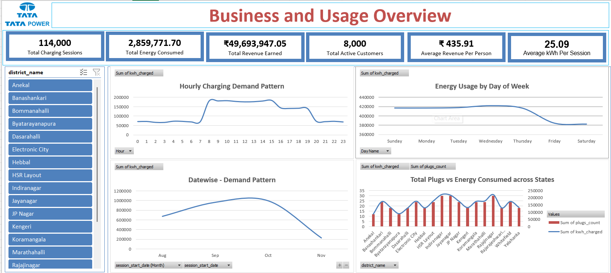
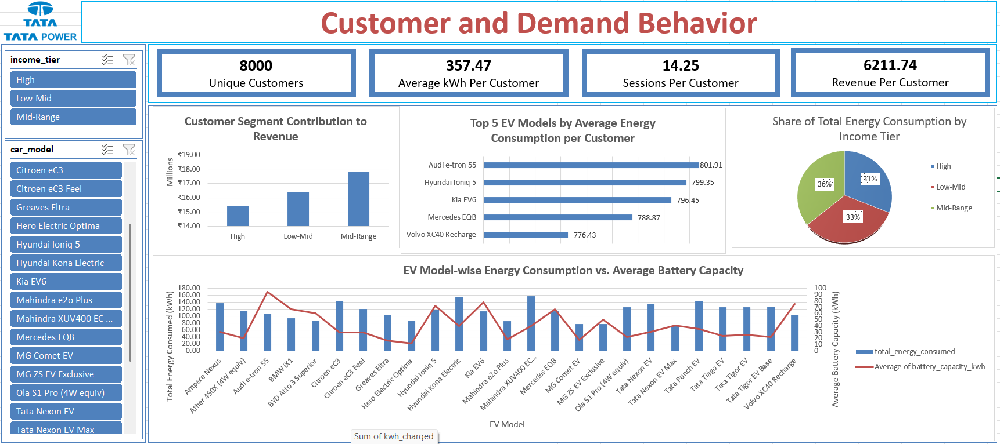

# Tata Power – EV Charging Network Analysis

An Excel-based data analytics project analysing EV charging network performance, customer behaviour, station operations and financial feasibility to support data-driven expansion decisions.

## Project Overview

This project analyses EV charging session data, customer demographics, charging station information and proposed expansion projects.

The objective is to understand charging demand, identify customer behaviour patterns, evaluate station-level performance and assess the financial viability of proposed charging infrastructure.

## Business Objectives

- Evaluate overall charging network performance and revenue.
- Analyse station-level charging demand across districts.
- Understand customer behaviour across income groups and EV models.
- Assess capital expenditure, payback period and projected ROI for expansion projects.
- Identify opportunities for improving network expansion decisions.

## Tools & Technologies

- **Microsoft Excel:** Data analysis, calculations and dashboards.
- **Power Query:** Data preparation and transformation.
- **PivotTables:** Aggregation and business analysis.
- **Excel Charts & Slicers:** Interactive dashboard development.

## Dataset Overview

The project uses six supporting data files covering:

- Charging sessions
- Charging stations
- Customer information
- District-level information
- Proposed expansion and ROI projects
- Data dictionary

## Dashboard Modules

### 1. Business & Usage Overview

Analyses overall network performance, charging demand and revenue.

### 2. Station Operations

Evaluates station-level session volumes, energy consumption and demand distribution across districts.

### 3. Customer & Demand Behaviour

Examines customer segments, income tiers, EV models, charging frequency and energy consumption.

### 4. Financial Performance & Expansion Strategy

Evaluates proposed projects using CAPEX, annual revenue, EBITDA, payback period, subsidies and five-year ROI.

## Methodology

1. **Data Understanding:** Reviewed the six source files and their data dictionaries to understand the datasets, columns and relationships.
2. **Data Preparation:** Used Power Query to clean, transform and prepare the datasets for analysis.
3. **Data Analysis:** Created PivotTables to analyse charging demand, station performance, customer behaviour and financial feasibility.
4. **Dashboard Development:** Built four interactive Excel dashboards using charts, KPIs and slicers.
5. **Business Insights:** Interpreted the results to identify customer trends, operational patterns and potential expansion opportunities.

## Dashboard Previews

### 1. Business & Usage Overview



### 2. Station Utilisation & Operations


### 3. Customer & Demand Behaviour



### 4. Financial Performance & Expansion Strategy


## Key Project Metrics

| Metric | Result |
|---|---:|
| Total Charging Sessions | 114,000 |
| Total Energy Consumed | 2.86 Million kWh |
| Total Revenue | ₹4.97 Crore |
| Active Customers | 8,000 |
| Charging Stations | 65 |
| Districts Covered | 18 |
| Proposed Expansion Projects | 98 |
| Average Project CAPEX | ₹142.06 Lakh |
| Average Payback Period | 4.61 Years |
| Average 5-Year ROI | 41.43% |

## Key Business Insights

- **Revenue Performance:** Generated approximately ₹4.97 crore in revenue across 114,000 charging sessions, with 2.86 million kWh of energy consumed.

- **Customer Behaviour:** The Mid-Range income segment contributed the highest total revenue (₹1.79 crore), while the Low-Mid segment generated the highest number of sessions (56,958).

- **Customer Value:** High-income customers recorded the highest average revenue per customer at approximately ₹12,979.

- **Charger Economics:** AC Level-2 (7.4 kW) projects had the shortest average payback period at 2.38 years, compared with 10.39 years for DC Ultra-fast (150 kW) projects.

- **District-Level Returns:** Bommanahalli recorded the highest average projected 5-year ROI at 144.73%, while Dasarahalli recorded the lowest at -21.77%. Each district had three proposed projects in this comparison.

- **Expansion Prioritisation:** Evaluated 98 proposed expansion projects and classified them into High, Medium and Low priority tiers based on financial feasibility and project potential.
- 
## Analytical Considerations

- Station-level performance is evaluated using charging sessions and energy consumption.
- Actual station occupancy or utilisation rates could not be calculated because session-duration and time-based plug-occupancy data were not available.
- Financial results represent projected expansion economics based on the supplied project dataset, not guaranteed future returns.

## Repository Structure

```text
Tata-Power-EV-Charging-Network-Analysis/
│
├── README.md
├── data/
│   ├── charging_sessions.csv
│   ├── charging_stations.csv
│   ├── customers.csv
│   ├── data_dictionary_Tata_Power.txt
│   ├── districts.csv
│   └── roi_bengaluru_districts.csv
│
├── dashboard/
│   └── TATA_POWER_DASHBOARD.xlsx
│
├── screenshots/
│   ├── 01-business-overview.png
│   ├── 02-station-operations.png
│   ├── 03-customer-behaviour.png
│   └── 04-financial-performance.png
│
└── presentation/
    └── Tata_Power_EV_Charging_Network_Analysis.pdf
```

## Project Deliverables

- [Excel Dashboard Workbook](dashboard/TATA_POWER_DASHBOARD.xlsx) – Complete Excel analysis with four interactive dashboards, PivotTables and supporting analysis.
- [Final Project Presentation](presentation/Tata_Power_EV_Charging_Network_Analysis.pdf) – Summary of the project, key findings and business recommendations.

## Author
Divya Bansal
**Data Analytics Portfolio Project**

Tools: Microsoft Excel | Power Query | PivotTables
