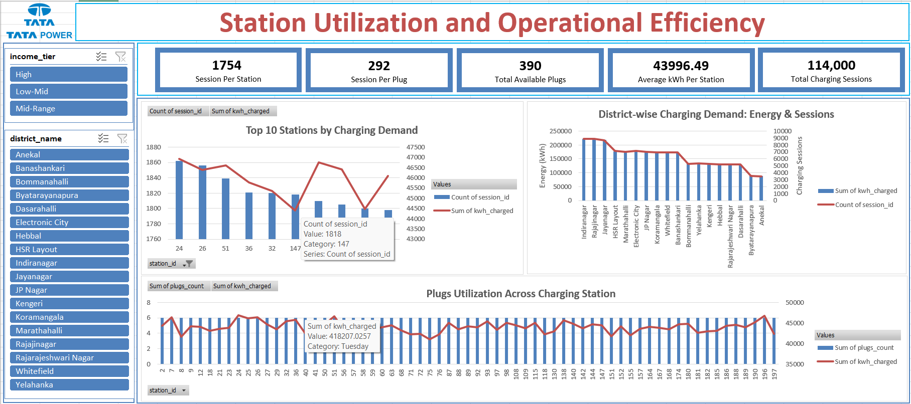
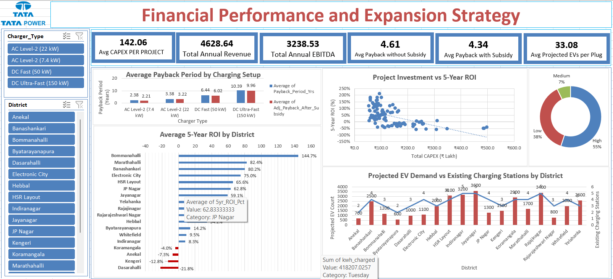

# Tata Power – EV Charging Network Analysis

An Excel-based data analytics project analysing EV charging network performance, customer behaviour, station operations and financial feasibility to support data-driven expansion decisions.

## Project Overview

This project analyses EV charging session data, customer demographics, charging station information and proposed expansion projects.

The objective is to understand charging demand, identify customer behaviour patterns, evaluate station-level performance and assess the financial viability of proposed charging infrastructure.

## Business Objectives

- Evaluate overall charging network performance and revenue.
- Analyse station-level charging demand across districts.
- Understand customer behaviour across income groups and EV models.
- Assess capital expenditure, payback period and projected ROI for expansion projects.
- Identify opportunities for improving network expansion decisions.

## Tools & Technologies

- **Microsoft Excel:** Data analysis, calculations and dashboards.
- **Power Query:** Data preparation and transformation.
- **PivotTables:** Aggregation and business analysis.
- **Excel Charts & Slicers:** Interactive dashboard development.

## Dataset Overview

The project uses six supporting data files covering:

- Charging sessions
- Charging stations
- Customer information
- District-level information
- Proposed expansion and ROI projects
- Data dictionary

## Dashboard Modules

### 1. Business & Usage Overview

Analyses overall network performance, charging demand and revenue.

### 2. Station Operations

Evaluates station-level session volumes, energy consumption and demand distribution across districts.

### 3. Customer & Demand Behaviour

Examines customer segments, income tiers, EV models, charging frequency and energy consumption.

### 4. Financial Performance & Expansion Strategy

Evaluates proposed projects using CAPEX, annual revenue, EBITDA, payback period, subsidies and five-year ROI.

## Dashboard Previews

### 1. Business & Usage Overview


### 2. Station Utilisation & Operations



### 3. Customer & Demand Behaviour


### 4. Financial Performance & Expansion Strategy



## Key Project Metrics

| Metric | Result |
|---|---:|
| Total Charging Sessions | 114,000 |
| Total Energy Consumed | 2.86 Million kWh |
| Total Revenue | ₹4.97 Crore |
| Active Customers | 8,000 |
| Charging Stations | 65 |
| Districts Covered | 18 |
| Proposed Expansion Projects | 98 |
| Average Project CAPEX | ₹142.06 Lakh |
| Average Payback Period | 4.61 Years |
| Average 5-Year ROI | 41.43% |

## Key Business Insights

- Generated approximately ₹4.97 crore in charging revenue across 114,000 sessions.
- Identified the Mid-Range income segment as the highest contributor to total revenue.
- Observed that the Low-Mid income segment generated the largest number of charging sessions.
- Found differences in project payback periods across charger categories, highlighting the financial trade-off between charging capacity and investment.
- Evaluated 98 proposed expansion projects to compare investment requirements and projected returns.
- Identified substantial variation in projected ROI across districts, supporting location-specific expansion decisions.

## Analytical Considerations

- Station-level performance is evaluated using charging sessions and energy consumption.
- Actual station occupancy or utilisation rates could not be calculated because session-duration and time-based plug-occupancy data were not available.
- Financial results represent projected expansion economics based on the supplied project dataset, not guaranteed future returns.

## Repository Structure

```text
Tata-Power-EV-Charging-Network-Analysis/
│
├── README.md
├── data/
│   ├── charging_sessions.csv
│   ├── charging_stations.csv
│   ├── customers.csv
│   ├── data_dictionary_Tata_Power.txt
│   ├── districts.csv
│   └── roi_bengaluru_districts.csv
│
├── dashboard/
│   └── TATA_POWER_DASHBOARD.xlsx
│
├── screenshots/
│   ├── 01-business-overview.png
│   ├── 02-station-operations.png
│   ├── 03-customer-behaviour.png
│   └── 04-financial-performance.png
│
└── presentation/
    └── Tata_Power_EV_Charging_Network_Analysis.pdf
```

## Project Deliverables

- **Interactive Excel Workbook:** Available in the `dashboard/` folder.
- **Dashboard Previews:** Available in the `screenshots/` folder.
- **Project Presentation:** Available in the `presentation/` folder.

## Author
Data Analytics Portfolio Project

Tools: Microsoft Excel | Power Query | PivotTables
**Data Analytics Portfolio Project**

Tools: Microsoft Excel | Power Query | PivotTables
